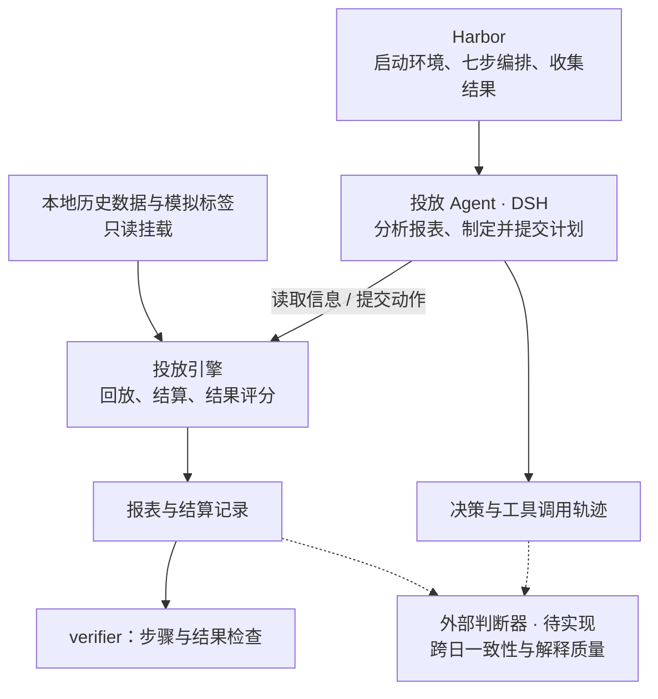

# Ad Scenario · 面向广告自动投放 Agent 的长程决策 Benchmark

如果把一周的广告投放交给 AI，它能否根据每天的反馈调整预算，在业务要求变化后及时修订策略，并说明自己为什么这样做？

Ad Scenario 围绕这个问题，使用 iPinYou 历史日志构建一个**七天、四个广告位组、有限预算**的投放环境。Agent 读取报表、提交额度与报价，环境逐笔回放结算，记录决策及其后果。评测同时关注投放效果、预算约束与跨日决策过程。

**当前阶段：Harbor 七步评测已端到端跑通（三个条件各 7/7 步，reward 取归一化投放分）。第二套 benchmark（AuctionNet）已完成源码与市场启动验证，业务层未实现。跨日逻辑一致性与决策可解释性计划由独立外部判断器评估，尚未实现。轨迹已可按事件粒度导出，并经过质量闸门筛选后进入 SFT 数据集。**

## 1. 从广告自动化需求出发

广告运营中的一部分工作具有持续、重复且依赖反馈的特点：读取日报，比较广告组表现，调整预算和报价，处理新的业务要求，再观察调整是否有效。这些工作为 AI Agent 提供了可能的应用空间。

可以把一个待研究的业务请求描述为：

> 为四个广告位组安排未来七天的投放。总预算有限，每天根据已有报表决定怎么分配、如何报价；预算或回报要求变化时重新规划，并解释关键调整。

本项目先研究其中的日常运营决策：预算节奏、组间分配、报价调整与业务变化响应。每次曝光的竞价与扣费由环境执行。素材生成、用户级定向和真实广告平台接入，留待后续扩展。

### Agent 实际运行时可能遇到什么

| 业务情形 | 可能出现的问题 | 需要观察的能力 |
|---|---|---|
| 消耗与点击已经发生，部分转化和收益尚未回传或计算完成 | 根据尚不完整的结果连续加码，或过早否定某个广告组 | 不完整反馈下的判断与调整 |
| 总预算覆盖多天 | 局部效果不错，却过早耗尽后续额度 | 跨日预算规划 |
| 不同广告组价格与回报不同 | 只看单一指标，忽略获取流量的实际成本 | 多指标权衡 |
| 中途收到预算收紧通知 | 沿用旧计划，没有按新额度重新计算 | 目标与约束更新 |
| 业务要求在回报可接受时扩量 | 为了规模牺牲回报，或过于保守而无法扩量 | 冲突目标下的决策 |
| 历史不足、转化样本稀少 | 把偶然结果当成稳定规律 | 不确定性识别 |
| 连续多天修改策略 | 判断前后冲突，解释与实际动作脱节 | 逻辑一致性与决策可解释性 |

这些问题构成 Benchmark 的任务设计依据。当前版本把其中一部分压缩为可控制、可重放的七天场景，再逐步补充更接近实际运行的因素。

## 2. Benchmark 调研

调研覆盖广告分析、自动出价、长程任务与工作产物评估。下表分别列出各项的考查点、可参考设计，以及当前项目实际采用的内容；仅调研而未采用的也予以保留。

| Benchmark | 核心作用 / 考查点 | 可参考点 | 本项目实际采用情况 |
|---|---|---|---|
| [AD-Bench](https://arxiv.org/abs/2602.14257) | 借助工具完成广告业务分析，评估答案正确性与调用过程 | 答案与工具轨迹分别评价 | **未采用**其任务、数据或环境 |
| [AuctionNet](https://proceedings.neurips.cc/paper_files/paper/2024/hash/ab9b7c23edfea0011507f7e1eae82cd2-Abstract-Datasets_and_Benchmarks_Track.html) | 多广告主竞争下的自动出价与预算管理 | 可交互的竞价环境、市场变化与策略效果评估 | **计划作为第二套 benchmark 并行引入**：源码已取、市场启动已验证；三池业务层与 Harbor task 未实现（见 §6） |
| [DABstep](https://huggingface.co/datasets/adyen/DABstep) | 根据支付数据与规则文档完成多步分析 | 业务口径理解、筛选与计算 | **未采用**其数据或任务 |
| [ClawMark](https://arxiv.org/abs/2604.23781) | 多轮、多日、有状态环境中的任务执行与变化响应 | 将时间推进、环境变化与结果检查结合 | **采用时间结构思路**：七次决策、跨日保留状态，并在指定日期发布预算与目标变化；未复用任务代码 |
| [VibeLifeBench](https://arxiv.org/abs/2608.10875) | 持续变化环境中的主动性与长期一致性 | 重新检查环境，以实际行动和状态评价任务 | **采用状态检查思路**：从提交计划与实际结算计算结果；主动巡检与跨日语义一致性尚未实现 |
| [DeepSWE](https://arxiv.org/abs/2607.07946)（工程任务基准） | 长程软件工程任务，以及实现是否满足需求 | 检查 verifier 是否误接受错误实现、误拒绝正确实现 | 仅作**验证器质量参照**；未复用其工程任务或测试 |
| [Terminal-Bench 2.0](https://www.tbench.ai/news/announcement-2-0) | 容器终端中的复杂任务执行 | 任务说明、环境、测试与奖励分开组织 | **采用任务组织方式**，编写 Harbor 七步任务与 verifier；未采用其终端任务集 |
| [GDPval](https://openai.com/index/gdpval/) | 真实职业任务中的工作产物质量 | 从实际业务要求出发定义产物与评价标准 | **未采用**其任务、专家 rubric 或评审流程 |
| [RSIBench-Data](https://arxiv.org/abs/2607.25886) | 固定后训练条件下，Agent 根据反馈改进数据策略的能力 | 固定比较条件，保留实验与失败证据 | **采用实验记录思路**：冻结数据与规则，保存每日观测、动作和结算；未引入训练闭环 |

调研也涉及相关方法与运行框架，其用途与 Benchmark 区分如下：

| 研究 / 框架 | 作用 | 可参考点 | 本项目实际采用情况 |
|---|---|---|---|
| [Gödel Forest](https://arxiv.org/abs/2609.36675) | 用搜索树与共享经验组织数据策略探索 | 保留候选、回退及共享失败经验 | **未采用**其搜索树或多 Agent 协同机制 |
| [RSIGym](https://arxiv.org/abs/2610.10310) | 将训练、推理、评测与沙盒服务化，管理预算和权限 | 分开管理 Agent 执行与评测服务 | **采用服务分层思路**：Agent 经 HTTP 读取报表、提交动作，数据与结算由引擎持有；未接入其服务 |
| [Harbor](https://docs.harborframework.com/tasks/overview) | Agent 任务运行与评测编排框架 | 容器环境、步骤执行、verifier、reward 与产物收集 | **已接入**：七步任务、容器环境、verifier 与 DSH 适配器端到端跑通，三个条件各 7/7 步 |

## 3. 场景与数据设计

### 数据底座

采用 [iPinYou 历史竞价日志](https://arxiv.org/abs/1407.7073)，主要考虑其连续日期、曝光价格与点击记录能够支撑逐笔回放。

| 项目 | 当前版本 |
|---|---|
| 时间 | 2013-06-06 至 2013-06-12，连续七天 |
| 广告位组 | 同一广告主，三个交易所，四个“交易所 × 广告位尺寸”组 |
| 数据规模 | 2,070,309 条曝光、1,659 次历史点击 |
| 转化与收益 | 历史转化仅匹配到 1 条；采用冻结的 222 个模拟转化标签，每次价值 ¥12 |
| 参考数据 | 取 training1st 的 2013-03-11~03-13 三天真实记录作为参考（另一广告主、距对局期约三个月），**仅供参照**，不作为「前一天历史」 |
| 复现约定 | `manifest.json` 记录来源、排序、去重、金额单位与文件哈希 |

曝光、成交价和点击来自历史数据；模拟转化、预算事件和特殊计价规则由环境定义。模拟 ROI 用于形成可控的回报约束，不代表原广告主的真实收益。

原始日志及其副本属于非公开输入，完整回放需要另行准备已授权的本地数据包。

### 每日决策流程

```text
发布前一日报表与当天生效的业务通知
    → Agent 分析已有信息
    → 为四组分别提交额度与报价
    → 环境逐笔回放并结算
    → 在下一决策日发布结果
```

全程共七次决策，Day 7 结束后统一结算。七天为模拟时间，无需等待七个自然日。

当前版本以自然日为决策粒度，每日统一发布上一日的聚合结果。这是回放环境的简化设定；实际平台可在日内更新部分指标，转化与收益也可能在更晚时间回传。日内调整与跨日转化回补尚未模拟。

Agent 只获得已经发布的聚合报表，包括各组消耗、赢标曝光、点击、模拟 ROI、市场价格分位数和剩余预算。逐笔成交价与结果标签由引擎持有。时间边界按上述规则设计，当前交互协议仍需完成严格验证。

### 三个独立剧本

| 剧本 | 业务条件 | 希望观察什么 |
|---|---|---|
| **0 · 稳定投放** | 七天总预算 ¥900，日参考上限 ¥150 | 能否从冷启动开始，根据反馈形成有效分配 |
| **A · 预算收紧** | Day 5 起总预算降为 ¥600，扣除已经发生的消耗 | 能否按新额度修订计划并管理后续投放 |
| **B · 回报约束下扩量** | Day 4 起，后四天 ROI 达到 35% 后，额外奖励曝光增长 | 能否在回报与规模之间调整策略 |

三个剧本分别开局、分别记账。同一剧本内，DSH 使用连续会话保留七天上下文；切换剧本时重新建立会话。

### 竞价、预算与评分

- 每组每天提交一个报价 `bid` 和额度 `budget`。当前额度按报价预留，可赢标次数上限为 `budget // bid`。
- 报价严格高于历史成交价才赢，平价输。一价组按报价扣费，二价组通常按历史成交价扣费。
- 二价组在 Day 3、6 使用隐藏计价：`max(历史成交价, ceil(0.8 × 报价))`。Agent 需要从后续报表中观察实际成本变化。
- 日上限为软约束：当日花费超出 ¥150 的部分，每 ¥1 扣 2 个等价点击。
- 总预算：剧本 0 / B 为硬约束，逐笔判负；**剧本 A 在第 5 天下调预算后，若累计花费已超新预算，自当日起冻结投放**（不再产生扣费），不额外判负，按实际结算跑完七天。理由是砍预算时钱已经花出去了，能做的只有止损；而超支的那几天**已经按日限额罚过分**，不再重复惩罚。
- 金额使用整数记账，¥1 = 100,000 单位；`ROI = (模拟转化价值 − 消耗) / 消耗`，零消耗时为空。

当前结果评分为：

```text
投放分 = 七天点击 − 日超限罚分 + 剧本 B 曝光加分
```

剧本 B 的曝光加分仅在 Day 4–7 ROI ≥ 35% 时启用，相对预先冻结的曝光参照值计算，增幅 10% 时加满，最多 15 个等价点击。分项返回点击、消耗、罚分、曝光加分与阶段 ROI，便于分析分数的来源。

**这部分评分描述投放结果。跨日逻辑一致性与决策可解释性需要单独评估，当前尚未计入分数。**

## 4. 在 Harbor 中组织完整运行

目标运行链路是：Harbor 启动环境，以七个步骤推进模拟日期；DSH 在每步读取信息、决策并提交计划；引擎回放结算；verifier 检查步骤与最终结果，Harbor 收集执行轨迹和 reward。



各层分工如下：

| 层 | 职责 |
|---|---|
| **Harbor** | 环境生命周期、步骤编排、测试执行、reward 与产物收集 |
| **DSH** | 模型调用、工具循环、同一剧本内的会话续接 |
| **投放引擎** | 私有数据读取、竞价回放、金额与收益结算、投放分计算 |
| **外部判断器** | 读取决策记录与可见证据，评估跨日判断与解释；待建设 |

当前已有 [七步任务配置](harbor_task/task.toml)、每日任务说明、verifier 与 [DSH 适配器](harbor_task/agents/dsh_agent.py)。三个条件均已通过 Harbor 完整运行，reward 取「投放分 ÷ 该条件基线」，跨条件可比。

完整运行的完成条件是：新环境启动后，Agent 在同一会话内准确完成七次决策，步骤不能越过授权日期，最终投放分能够进入 reward，观测、动作、工具结果和结算可以一起回看。这条链路已经跑通；下表为最近一次三个条件的结果。

## 5. 当前运行带来的阶段发现

### 预算使用方式需要与投放结果一起分析

两个模型 × 三个条件 × **各 3 次重复**，共 18 次完整七天运行：

| 条件 | 模型 | n | 归一化均值 | 极差 | 明细 |
|---|---|---:|---:|---:|---|
| 0 · 稳定投放 | deepseek | 3 | **1.030** | 0.539 | 1.164 / 0.694 / 1.233 |
| 0 · 稳定投放 | GLM | 3 | **0.373** | **1.245** | −0.256 / 0.989 / 0.387 |
| A · 预算收紧 | deepseek | 3 | **0.955** | 0.356 | 0.924 / 0.793 / 1.149 |
| A · 预算收紧 | GLM | 3 | **0.290** | **1.188** | −0.387 / 0.801 / 0.455 |
| B · 回报约束下扩量 | deepseek | 3 | **0.994** | 0.298 | 1.163 / 0.865 / 0.955 |
| B · 回报约束下扩量 | GLM | 3 | **0.759** | **1.064** | 1.223 / 0.159 / 0.896 |

三件事值得记下来：

1. **单次结果完全不可用。** 同一模型同一条件的极差从 0.30（deepseek · B）到 1.25（GLM · 0），**比两个模型之间的差距还大**。不做重复就无法得出任何模型结论。
2. **deepseek 在三个条件上均值都在 0.96–1.03，极差 0.30–0.54**；GLM 均值 0.29–0.76，**极差 1.06–1.25**——不仅偏低，而且不稳定。
3. **GLM 出现过两次负分**（−0.256、−0.387）：花费接近满额，点击却抵不过日超限罚款。典型样本是 `m5r3-glm-A`：点击 214、花费 ¥600、罚分 408.68、**主分 −194.68**。

另外，剧本 A 的「预算下调后冻结投放」在 6 次真实运行中**一次都没有触发**——所有运行在第 4 天结束时的累计花费都低于 ¥600（最高 ¥569.5），冻结逻辑目前只有工程验证，没有真实样本。

后续比较不同模型时，需要同时报告点击、消耗、CPC、分阶段 ROI、罚分、调用成本与重复次数。

### “按天决策”需要由环境保证

探索中，Agent 曾在一个外层步骤中连续提交多天计划。只检查每个日期有没有提交，仍可能让它提前获得后续反馈并继续操作。[执行入口](agent/dsh_runner.py)已经记录到天数异常，但严格限制仍需要运行框架与引擎协议共同完成。

这类轨迹可以暴露环境问题，不能直接用于评估“次日反馈下的决策能力”。Harbor 接入需要检查每一步到底放出了什么信息、接受了哪些动作。

### 可重复的分数依赖完整的规则版本

隐藏计价会提高过高报价的实际成本；组额度按报价预留，也会限制高报价可以买到的曝光量。同一个动作在不同规则下，可能得到不同的成本与结果。

因此，后续每次评测都需要关联数据、计价、任务和评分版本。运行出一个分数之后，还应能追溯该分数对应的观测和动作。

### 问题需要分层归因

| 层次 | 已发现的情况 | 对评测的影响 |
|---|---|---|
| 数据与任务适配 | 历史转化过少、前期历史缺失 | 需要明确模拟收益和冷启动条件，避免把模拟 ROI 当成真实效果 |
| 运行环境 | DSH 曾遇到 HOME 与日志目录的写权限问题 | 应先定位环境错误，避免直接记为模型失败 |
| 协议与评分 | 多日连续提交（已用每日令牌封堵）、重复提交、日序不符（已改为精确匹配） | 修复后需用新轨迹复验；旧轨迹不能自动视为有效成绩 |
| Agent 决策 | 已能观察额度、报价和消耗的变化 | 对能力强弱的判断，需要等待合规运行与重复实验 |

这些发现首先说明了评测环境需要补齐哪些边界。关于模型在预算收紧、扩量和长期判断中的表现，仍需等待三个剧本在 Harbor 中完整运行后的对照结果。

## 6. 理想评估中尚未完成的部分

### 独立的跨日逻辑与解释评估

结算引擎可以计算花了多少钱、买到多少曝光、是否触发预算规则。判断“今天的解释是否与昨天冲突”“新增证据是否足以支持策略变化”，还需要一个独立的外部判断器。

计划让 Agent 在每日动作之外，提交简短、可观察的决策记录：**主要判断、证据引用、行动意图、不确定项，以及对先前判断的修订说明**。外部判断器基于这些记录、截至当时已经发布的报表和业务通知进行评估。

| 评估维度 | 判断器需要回答的问题 |
|---|---|
| **跨日逻辑一致性** | 前后的判断是否冲突？若发生修订，是否解释了新证据、目标变化或主动探索的原因？ |
| **决策可解释性** | 给出的依据是否真实存在、是否来自当时可见信息、是否与实际动作对应？ |
| **不确定性处理** | 数据不足时是否承认判断边界？是否把短期波动误写成确定结论？ |

例如，Agent 前一天因某组回报不足而减少预算，后一天增加预算，判断器需要区分：新报表是否显示改善，业务目标是否变化，是否进行了有明确目的的探索，或者只是无依据地改变说法。策略变化本身不能直接判成逻辑错误。

实现上计划分两层：程序检查数值、日期和证据引用，独立评估模型依据固定 rubric 检查语义关系。判断器输出分项结论、对应证据和置信度，对难以判断或存在分歧的样例进行人工复核。它的判断仍需通过人工标注样例校准，评估一致性和误判率。

**当前尚未实现独立判断器、统一决策记录和校准样例。** 在完成这部分之前，投放结果分与过程质量应分开报告；也不能仅凭一段合理解释，认定策略在因果上正确或接近最优。

### 第二套 Benchmark：AuctionNet（独立运行，未实现）

现有 iPinYou 反映的是「固定历史市场下，Agent 如何分配预算与报价」。它无法回答另一类问题：**当我们的出价会改变竞争结果时，策略还能不能站住**。为此计划并行引入 [AuctionNet](https://proceedings.neurips.cc/paper_files/paper/2024/hash/ab9b7c23edfea0011507f7e1eae82cd2-Abstract-Datasets_and_Benchmarks_Track.html)，两套 benchmark 独立报告结果，暂不合并总分，也不直接比较原始分数。

| 维度 | iPinYou（现有） | AuctionNet（计划中） |
|---|---|---|
| 市场来源 | 固定历史日志回放 | 多竞争者参与的模拟市场 |
| 投放对象 | 四个广告位组 | 三个广告池 |
| 市场反馈 | 历史成交价与结果标签 | 出价、竞争者预算与策略共同决定结果 |
| 主要结果 | 点击、消耗 | 曝光、转化、消耗、CPA |
| 业务流程 | 七天现有逻辑 | 在 AuctionNet 外层新增七天业务层 |

**业务结构**：一个广告主 + 一个 Agent + 三个广告池 + 一份共享总预算。Agent 管理的是三个池的预算与出价参数，不是三个独立竞价主体；每次曝光机会属于某个池，我方只提交一份出价。AuctionNet 原生 episode 里的三个「展示位置」是同一次拍卖中的排名位，**不能当成这里的三个广告池**。

**分层**：Agent 每天提交三池的预算与出价参数，适配器把参数转换成逐次曝光的报价（例如「出价系数 × 预测转化概率」），**不要求 LLM 为每次曝光报价**；池预算与总预算由服务端统一检查，所有池的消耗进入同一份台账。计价单位需单独定义，不沿用 iPinYou 的 CPM 整数单位。

**七天与不完整反馈**：AuctionNet 原生 episode 会重置预算等状态，连续跑七个 episode 不等于七天经营。外层需保存跨日的预算、累计消耗、历史报表与已生效约束；市场变化（流量、转化价值、竞争）与内部变化（预算、目标、授权）分开配置；反馈层区分「已发生」与「Agent 当前可见」，允许转化延迟回传并标注统计时间。

**指标口径**：AuctionNet 的竞价结果包含曝光与模拟转化，**没有独立实现的点击结果**，因此不能把预测点击率或转化数当作点击数。新 benchmark 先提供曝光、转化、消耗、CPA、预算遵守情况与任务完成情况；收益与 ROI 需先定义收益模型与假设。

**已完成的前置验证**（不代表功能已实现）：

- `external/AuctionNet/` 已取官方源码（commit `c20de63`），未修改。
- `auctionnet_runtime/` 为独立 Python 3.9 环境；旧版 PyTorch 的动态库兼容问题已在私有环境修复，记录见 `runtime-compatibility.json`，**容器内需重新验证**。
- 原版市场完成一次 48 时段运行（48 个竞价主体、约 50 万次曝光机会），结果见 `work/auctionnet/market-smoke.json`；学习模型流量生成器另做 4,096 条样本检查。
- 三广告池、七天业务层、独立 Harbor task 均**尚未实现**。

**已知问题**：默认被测策略依赖自行训练的模型，当前用仓库附带的 IQL 模型仅作环境验证；`NeurIPSPvGen.reset()` 会恢复默认流量参数，小流量设置未保留，适配时需修复参数延续；暂不需要约 80 GB 的离线轨迹集。

**Harbor 接入**：iPinYou 原 task 保留，AuctionNet 新增独立七步 task；每步只允许提交当天计划并推进一天，拒绝跨日提交、重复推进与运行中切换 benchmark。两套环境分别完成真实的七步运行，保存调用链、日报、最终台账与评分；资源额度需单独测量，不照搬旧 task。

### 更贴近实际投放的环境与实验

| 待补充项 | 为什么需要 | 当前边界 |
|---|---|---|
| **Harbor 完整运行** | 统一环境、日期推进、测试与结果记录 | ✅ 已跑通；verifier 仍与 agent 同沙箱，防篡改需加固 |
| **多模型与重复实验** | 区分模型差异、偶然性与运行异常 | 当前主要是单一 DSH 探索记录 |
| **更丰富的反馈机制** | 转化可能延迟、回补，数据质量也会波动 | 目前主要为次日反馈与固定模拟标签 |
| **更真实的市场变化** | 竞争、流量与用户行为可能响应策略 | 当前只回放历史记录，复用固定结果标签 |
| **更广的任务分布** | 检查跨日期、预算条件与业务事件的泛化 | 当前只有固定七天、四组与三个剧本 |
| **模型与工具成本核算** | 评估持续运行的实际代价 | 尚无完整统一的调用成本报告 |

当前环境用可控制的规则近似部分业务约束。其分数描述这一环境中的表现，真实线上收益仍需后续实验验证。

## 7. 后续轨迹用途

环境稳定后，计划运行多个模型，按结果、过程质量和成本筛选轨迹：保留完整任务背景、每天可见的历史、动作、工具结果、奖励分项及失败归因。

- **SFT**：选择合规且质量较高的连续决策轨迹，保留历史上下文与公开决策说明，排除未来信息、私有标签和依赖环境漏洞的成功。
- **RL**：提供可重置环境、观测与动作协议、版本化奖励及可审计轨迹。外部判断器若用于奖励，还需要单独验证可靠性与抗投机能力。

这部分已有可用的最小实现：

- **事件级导出**：`events.jsonl` 逐条保留思考、工具调用与工具结果，可直接回放。
- **七日训练导出**：`python3 tools/export_trajectories.py <run_dir>` 为每个 trial 导出一条连续七日的 `export/sft.jsonl`，保留完整消息、工具参数与返回、逐消息 loss mask、七个步骤的身份与消息区间；`export/rl.jsonl` 保留同一段完整交互和整轮奖励。字段及采集要求见 [接口约定](tools/接口约定.md)。
- **调用链阅读器**：`python3 viewer/events.py work/harbor-jobs/script0/export/events.jsonl`，然后用浏览器打开同目录的 `events.html`。按天阅读任务指令、思考、调用参数、返回和验收，支持全文搜索、`#序号` 定位及原始事件视图；也可拖入其他 JSONL 文件。HTML 自带数据，可离线使用，无需安装依赖。加 `--serve` 可一键用 Google 翻译全部思考，保留原文并缓存译文。详见 [viewer/README.md](viewer/README.md)。
- **质量闸门**：`quality_gate.py` 按严重度识别协议违规（多次提交、跨日令牌）、令牌猎取（在文件系统里搜索凭据）、窥探验收脚本等行为，判定 `clean / review / exclude`。
- **择优入库**：`python3 tools/promote_sft.py <run_dir> --min-reward 1.2` 以整段七日为单位，要求七个步骤都有同 trial 的完整 clean 结果、整轮有效分数达标、执行上下文采齐。缺少 system prompt、真实工具定义或执行时指令来源的记录会拒绝或标为 review，不自动进入 `sft_promoted.jsonl`。高分与 clean 是筛选条件，逐日动作质量仍需另行评估。

轨迹的训练价值仍需通过后续训练与独立评测确认。

## 8. 运行与文件入口

完整回放需要已授权的本地数据，目录结构如下：

```text
pkg/
├── manifest.json
├── history/day_01.jsonl … day_07.jsonl
├── simulation/roi_v1.json
├── daily_summary.json
└── reference_prior.json
```

引擎使用 Python 标准库，容器参考环境为 Python 3.12，无需 GPU。现有引擎运行、环境构建和检查说明见 [engine/README.md](engine/README.md) 与 [docker/README.md](docker/README.md)。原始数据及其副本的公开排除、可分发的小规模样例仍需完善。

| 入口 | 内容 |
|---|---|
| [engine/](engine/) | 历史数据读取、回放、结算与结果评分 |
| [server/](server/) | 报表、计划与结算 HTTP 接口 |
| [agent/](agent/) | DSH 连续会话及投放交互入口 |
| [harbor_task/](harbor_task/) | 七步任务、容器环境、verifier 与 DSH 适配器 |
| `external/AuctionNet/` | 第二套 benchmark 的官方源码（未修改），来源与版本见 `external/*.json` |
| `auctionnet_runtime/` | 独立 Python 3.9 运行环境与启动探针 |

## 查看调用链

`events.jsonl` 可以用仓库自带的小工具在浏览器里阅读：按天查看指令、思考、工具调用与验收结果，并支持**把思考逐段翻译成中文**。

```bash
python3 viewer/events.py path/to/events.jsonl --serve
```

详见 [viewer/README.md](viewer/README.md)。

## 跑下来发现的几类问题

**环境 / harness 侧**

1. **控制参数的边界与归属不清**：进程终止、会话写锁、重试、输出上限、目录权限分散在编排层、agent 运行时和我们的桥接层，没有一份契约写清谁兜底。典型表现是「报错位置不是故障位置」。
2. **提示词信息泄漏**：令牌写在当天指令里，仓库又保存了全部七天的令牌——只要能读到文件或历史记录，就能提前拿到未来信息。未来信息必须**不可达**，而不只是不可提交。
3. **关键参数被护栏过滤**：工具沙箱会拦掉带敏感名的环境变量，凭证静默消失。护栏本身合理，问题是没有提示。

**模型侧**

1. **持续提交导致单日超时**：提交成功后仍反复确认，撞上限流后长时间等待，最终拖垮当天并连带影响次日。
2. **不做当日历史查询就提交**：缺少信息依据的计划即使分数不低，也不能作为有效决策样本。
3. **顶着单日超额惩罚换点击**：主动超日限额、以罚款换点击量。这是策略而非缺陷，但只看点击会误判。

**方法论**：同一模型同一条件的分数极差可达 0.47（deepseek）到 1.245（GLM），**单次结果不可用于模型比较**；正式结论至少需要 3 次重复，并同时报告均值、极差、罚分与花费。

本文记录截至 2026-11-24 已核对的运行情况。Harbor 接入与后续实验继续推进，正式结果及完成状态将随验证记录更新。
