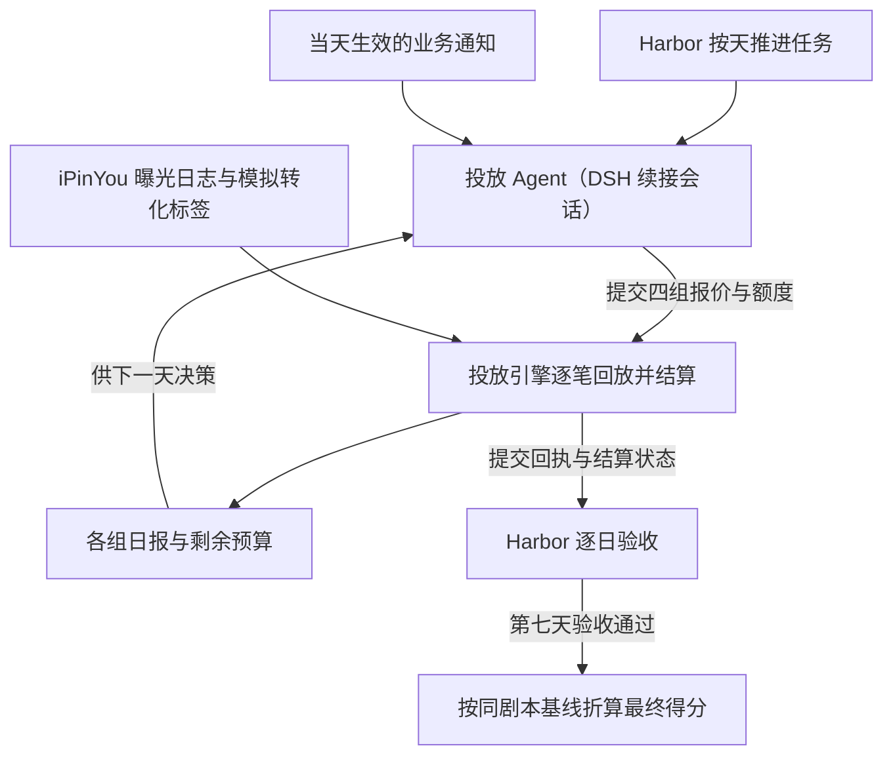

# Ad Scenario · 面向广告自动投放 Agent 的长程决策 Benchmark

如果把一周的广告投放交给 AI，它能否根据每天的反馈调整预算，在业务要求变化后及时修订策略，并说明自己为什么这样做？

Ad Scenario 围绕这个问题，使用 iPinYou 历史日志构建一个**七天、四个广告位组、有限预算**的投放环境。Agent 读取报表、提交额度与报价，环境逐笔回放结算，记录决策及其后果。评测同时关注投放效果、预算约束与跨日决策过程。

已完成两个模型在三个剧本下的 **18 轮七天运行**。[查看运行结果](#results)

**目录**

1. [从需求出发](#goals)
2. [Benchmark 调研](#related-work)
3. [场景与数据设计](#scenario)
4. [Harbor运行与评分](#harbor)
5. [实验结果与发现](#results)
6. [理想评估中尚未完成的部分](#future-work)
7. [运行轨迹与SFT训练数据](#trajectories)
8. [复现与项目入口](#reproduce)

<a id="goals" name="goals"></a>

## 从需求出发

广告运营每天都要读取日报，比较广告组表现，调整预算和报价，再观察调整是否有效。如果客户在周中改了要求，运营还得把已经花掉的钱和剩余的投放天数算进新计划。

> 为四个广告位组安排未来七天的投放。总预算有限，每天根据已有报表决定怎么分配、如何报价。预算或回报要求变化时，重新规划，并解释关键调整。

这个 Benchmark 把预算节奏、组间分配和报价交给 Agent，把每次曝光的竞价与扣费交给环境。这样，同一个业务请求既能留下七天的投放结果，也能留下 Agent 每次调整计划时所依据的日报和理由。

### Agent 实际运行时可能遇到什么

| 业务情形 | 可能出现的问题 | 需要观察的能力 |
|---|---|---|
| 总预算覆盖多天 | 局部效果不错，却过早耗尽后续额度 | 跨日预算规划 |
| 不同广告组价格与回报不同 | 只看单一指标，忽略获取流量的实际成本 | 多指标权衡 |
| 中途收到预算收紧通知 | 沿用旧计划，没有按新额度重新计算 | 目标与约束更新 |
| 业务要求在回报可接受时扩量 | 为了规模牺牲回报，或过于保守而无法扩量 | 冲突目标下的决策 |
| 历史不足、转化样本稀少 | 把偶然结果当成稳定规律 | 不确定性识别 |
| 连续多天修改策略 | 判断前后冲突，解释与实际动作脱节 | 逻辑一致性与决策可解释性 |

<a id="related-work" name="related-work"></a>

## Benchmark 调研

假设一个广告位组昨天的点击成本最低，Agent 今天决定给它更多预算。这次加投的依据、实际取得的流量，以及预算变化后的调整，分别对应广告分析、竞价和跨日决策。要让这些决策可以复现，还需要能独立运行和验证的任务。

| Benchmark | 核心作用 / 考查点 | 可参考点 | 本项目实际采用情况 |
|---|---|---|---|
| [AD-Bench](https://arxiv.org/abs/2602.14257) | 调用广告平台工具回答业务问题，检查答案与工具调用轨迹 | 结合分析结论与查询过程，判断 Agent 是否读懂报表 | 仅作广告分析任务的对照。 |
| [AuctionNet](https://proceedings.neurips.cc/paper_files/paper/2024/hash/ab9b7c23edfea0011507f7e1eae82cd2-Abstract-Datasets_and_Benchmarks_Track.html) | 让多个竞价 Agent 在同一市场出价，比较策略的投放效果 | 观察报价如何影响赢得的曝光和实际消耗 | 当前七天评测使用 iPinYou 历史回放。AuctionNet 作为第二套环境，用于验证 Agent 在动态变化的市场中的更长期表现，业务层待实现。 |
| [ClawMark](https://arxiv.org/abs/2604.23781) | 任务跨越多个工作日，环境在两轮之间变化，考查 Agent 如何接续工作 | 保留前一天的状态，在任务途中引入新的业务要求 | 采用跨日任务结构。已花预算逐日累计，Agent 要结合最新报表和预算通知修订计划。 |
| [Terminal-Bench 2.0](https://www.tbench.ai/news/announcement-2-0) | 在终端环境中执行任务，通过测试检查完成情况 | 将任务说明、运行环境和验证程序分开组织 | 采用这种组织方式，用 Harbor 运行七天投放任务，由验证程序检查每日提交和最终结算。 |

**实验方法与框架参考**

| 研究 / 框架 | 作用 | 可参考点 | 本项目实际采用情况 |
|---|---|---|---|
| [RSIBench-Data](https://arxiv.org/abs/2607.25886) | 固定目标模型与训练条件，考查 Agent 能否根据评测反馈改进训练数据策略 | 固定比较条件，保留每次尝试及其结果，便于回查哪些调整有效 | 同一剧本使用相同的回放数据和结算规则，逐日保存 Agent 可见的报表、提交的计划和实际结算。 |
| [RSIGym](https://arxiv.org/abs/2610.10310) | 将训练、推理和评测封装为服务，通过接口控制 Agent 的访问权限 | 明确哪些操作交给 Agent，哪些数据和结果由服务端掌管 | 借鉴服务分层思路。Agent 通过接口读取日报、提交计划，项目自建的投放引擎保管逐笔日志并负责结算。 |

因此，Ad Scenario 把一轮评测定义为一周连续的投放。今天的日报支持怎样的判断、提交的计划产生什么结果、这个结果又怎样影响明天的决定，都可以在同一轮运行中追踪。

<a id="scenario" name="scenario"></a>

## 场景与数据设计

### 回放数据来源

要评估 Agent 能否根据前一天的投放结果调整预算，首先需要一段连续的市场记录，既能看出每个广告位组的流量和价格如何变化，也能核对买下这些曝光带来了多少点击。

项目选取 iPinYou 中同一广告主在 2013 年 6 月 6–12 日的日志，按交易所和广告位尺寸将流量划为四组，共有 **2,070,309 条曝光记录、1,659 次历史点击**。回放用到曝光时间、所属组、历史成交价和点击结果。用同一批记录回放不同计划，就能比较 Agent 怎样分配预算、怎样出价，以及这些决定对花费和点击的影响。[iPinYou 数据说明](https://arxiv.org/abs/1407.7073)

这批数据足以模拟按日报调整投放的工作过程。市场价格沿用历史记录，其他竞价者不会随 Agent 的报价作出反应。这七天也只匹配到 1 次历史转化，日志没有记录这次转化带来的收入。

### 业务场景仿真

三个剧本共用同一周的流量，各自从 900 元预算开始，独立记账。广告主的共同目标是在七天内获得尽可能多的点击，每日花费的参考上限为 150 元。在此基础上，剧本分别改变客户对预算和回报的要求。

| 业务情形 | 对应剧本 | 如何设计 |
|---|---|---|
| 客户给定一周预算，由运营决定每天怎么花 | **0 · 稳定投放** | 七天内预算和点击目标保持稳定，观察 Agent 如何根据各组的花费与点击调整后续分配。 |
| 投放进行到一半，客户削减预算 | **A · 预算收紧** | 第 5 天通知 Agent，整周预算降至 600 元。前四天的花费计入新总额，Agent 需要用剩余预算安排最后三天。 |
| 客户希望扩大曝光，同时对回报有要求 | **B · 回报约束下扩量** | 第 4 天加入扩量目标。第 4–7 天合计模拟 ROI 达到 35% 时，超过固定参照值的曝光才有额外奖励。 |

为让剧本 B 的回报要求可以检验，项目从有历史点击的曝光中固定选出 **222 条作为模拟转化，每次价值 12 元**。所有运行共用这组标签，只有买到对应曝光才计入模拟收入。阶段 ROI 按（模拟收入 − 该阶段花费）÷ 该阶段花费计算。

### 决策与回放流程设计

1. **读取反馈，提交计划。** 第一天还没有本轮投放记录。从第二天起，Agent 可以看到上一日各组的曝光、点击、花费和模拟 ROI。它结合剩余预算和当天生效的业务通知，为四组分别提交当天的报价与额度。
2. **逐笔判断赢标并扣费。** 引擎按时间顺序回放，报价严格高于历史成交价才有机会赢标。每组按报价预留额度，最多可赢的曝光数取“额度 ÷ 报价”的整数部分。因此，提高报价可以争取价格更高的曝光，也可能减少这笔额度最多能买到的曝光数。两个一价组按自己的报价扣费，另两个二价组通常按历史成交价扣费。
3. **生成日报，结转余额。** 引擎只对赢下的曝光累计历史点击和模拟转化，按组汇总当天结果，用实际花费更新周预算余额。这份日报和剩余预算一起成为下一天决策的依据。

> **备注 1 · 一价与二价**　假设你出价 10 元，其他竞价者的最高出价为 8 元。你赢标后，**一价拍卖**按自己的出价付 10 元，**二价拍卖**按第二高价付 8 元。回放中用历史成交价代表其他竞价者的最高出价。
>
> **备注 2 · 二价组的隐藏计价规则**　为让一味抬高报价的策略付出成本，引擎在第 3、6 天对二价组采用特殊计价。每次赢标按 `max(历史成交价, ceil(0.8 × Agent 报价))` 扣费，其中 `ceil` 表示按最小计价单位向上取整。这条规则不告知被测 Agent。

<a id="harbor" name="harbor"></a>

## Harbor运行与评分

### 七天任务如何连续运行

Harbor 将一个剧本拆成七个步骤，每步对应一个模拟投放日。七步共用同一个投放引擎，前一天花掉的预算会影响后面几天还能花多少。DSH 负责运行被测 Agent，并在同一剧本内续接会话，让 Agent 可以回看此前的计划，对照新收到的日报调整策略。[七步任务配置](harbor_task/task.toml) · [DSH 适配器](harbor_task/agents/dsh_agent.py)

每天结束时，Harbor 的验收程序检查引擎是否已结算到当天，以及当天的计划是否有提交回执。前六天逐日验收，通过后才进入下一天。第七天完成同样的核对后，验收程序读取整周投放分，换算为这轮运行的最终得分（reward）。[首日验收](harbor_task/steps/day1/tests/test.sh) · [末日验收](harbor_task/steps/day7/tests/test.sh)

### 七天投放如何计分

广告主希望在预算内获得尽可能多的点击。引擎以每次点击 1 分为基础，再按预算和扩量要求调整得分。

**投放分 = 七天总点击数 − 每日超限罚分之和 + 剧本 B 曝光加分**

| 业务要求 | 计分方式 |
|---|---|
| 控制每日花费 | 每天单独计算，实际花费超过 150 元的部分，每元扣 2 分。例如某天花了 160 元，当天扣 20 分。 |
| 守住整周预算 | 若一笔新扣费会突破当时生效的总预算，引擎判负，整轮投放分归零。剧本 A 在第 5 天下调预算时，若此前花费已超过 600 元，则冻结后续投放，按实际取得的结果计分。 |
| 剧本 B 在回报达标后扩大曝光 | 第 4–7 天合计模拟 ROI 达到 35% 后，同期赢标曝光超过 561,234 次的部分才有加分。曝光比参照值多 5% 加 7.5 分，多 10% 及以上加满 15 分。 |

为了判断 Agent 是否胜过简单的投放策略，每个剧本都用固定报价策略跑一遍作为基线。该策略把剩余预算按剩余天数均摊，每天最多分配 150 元，再平分给四组。剧本 0、A、B 的基线投放分分别为 **613、503、613**。Harbor 记录的 **reward = Agent 投放分 ÷ 同剧本基线投放分**。实验结果中的 1.00 表示与基线持平，1.10 表示投放分比基线高 10%。[投放评分](engine/score.py) · [规则基线](engine/baseline.py)

### 运行结构图



<a id="results" name="results"></a>

## 实验结果与发现

### 不同模型表现差异巨大，可以肯定现阶段的评估价值

本轮评测使用 **DeepSeek-V4.1-Flash-1017** 和 **GLM-5.3-Flash**，Agent运行环境均为Deepseek Harness, 提供同等 python 环境。两个模型在相同的回放数据和评分规则下分别完成三个剧本，每个剧本独立运行三次，共 18 轮七天投放。

每轮得分都以同剧本的规则基线归一化，**1.000 表示与基线持平**。下表列出三次运行的平均得分，以及最高分与最低分之差（极差）。

| 剧本 | 模型 | 归一化均值 | 极差 | 三次明细（按批次） |
|---|---|---:|---:|---|
| 0 · 稳定投放 | DeepSeek-V4.1-Flash-1017 | **0.781** | 0.267 | 0.940 / 0.731 / 0.673 |
| 0 · 稳定投放 | GLM-5.3-Flash | **1.225** | 0.426 | 1.388 / 1.325 / 0.962 |
| A · 预算收紧 | DeepSeek-V4.1-Flash-1017 | **1.321** | 0.260 | 1.332 / 1.185 / 1.445 |
| A · 预算收紧 | GLM-5.3-Flash | **0.562** | **1.247** | **−0.220** / 1.027 / 0.878 |
| B · 回报约束下扩量 | DeepSeek-V4.1-Flash-1017 | **1.392** | **0.044** | 1.408 / 1.364 / 1.404 |
| B · 回报约束下扩量 | GLM-5.3-Flash | **1.048** | 0.711 | 0.677 / 1.078 / 1.388 |

DeepSeek 同一剧本内三次运行的结果比较集中（极差 0.04–0.27），但三个剧本的水平并不一致：稳定投放低于基线（0.781），预算收紧与扩量则明显高于基线（1.321、1.392）。GLM 的剧本间差异更大：**在稳定投放剧本上高于 DeepSeek（1.225 对 0.781），在预算收紧剧本上明显落后（0.562 对 1.321）**。

差距可以逐日追溯。GLM 在预算收紧剧本中唯一一次负分（−0.220）来自第 3 天：当天花费 ¥393.2，超出日上限 ¥150，被扣 486.48 分；此后累计花费已达 ¥616，超过第 5 天下调后的 ¥600 总预算，**触发冻结投放，第 5–7 天不再花钱**，最终 376 次点击、投放分 −110.48。同一模型的另外两轮在同一剧本下分别得到 1.027 和 0.878——它们第 3 天同样超了日上限（¥176 和 ¥225），但幅度可控，罚分只有 52.24 和 150.35。

这也说明评分能落到「哪一天、哪条规则」上，而不是只给一个总分。

### 同一模型表现方差较大，提示存在 SFT 提升空间

最典型的一格是 GLM 的预算收紧剧本：三次得到 **−0.220 / 1.027 / 0.878**，极差 1.247，是全部六格中唯一出现过负分的一格。失败那轮的第 3 天单日花费 ¥393，是另外两轮（¥176、¥225）的两倍左右——**同一个模型、同一份指令、同样的参考数据，差异集中在「隐藏定价日愿不愿意压低出价」这一个决策上**。

对照之下，DeepSeek 在扩量剧本上的三次是 1.408 / 1.364 / 1.404，极差仅 0.044：只有一轮在第 3 天轻微超限（¥178，罚 56.5 分），其余每天都在 ¥150 以内。

利用这一 Benchmark，可以批量生成带有正负反馈的投放决策样本，用于监督微调（SFT），以提升模型在相应投放场景中的决策能力。

### 提示词泄漏会严重影响评估结果

这个任务里有很多「知道就能拿分」的信息：第 3、6 天是隐藏定价日（结算价取市场价与 0.8×出价中的较高者）、第 5 天总预算下调、每天的提交令牌、验收脚本的判断口径。任何一项提前暴露，分数都会虚高，而且**不同运行之间不再可比**。

我们实际检查出三个暴露面：

- **令牌**：提交令牌每天一枚，写在当天指令里；但仓库中的 `server/day_tokens.json` 保存着全部七天。只要 Agent 能读到仓库或历史日志，就能提前提交未来几天。
- **验收目录**：早期 `/tests`、`/logs/verifier` 对 Agent 可读（Harbor 在每次步骤切换时会重置目录权限），等于把判分逻辑摊开。
- **文档**：剧本 A/B 的规则、隐藏定价日、预算下调日写在 README 与方案里，这是给人看的必要说明，**留在文档里没有问题**；问题在于**被测 Agent 的运行环境中不应出现这些文档**——容器不挂载仓库，也不把 README 与方案打进镜像。一旦它们对 Agent 可见，等于直接把答案交出去。

处理办法的核心是「**用引擎强制，而不是靠提示词自觉**」：

1. **步骤闸门**：引擎只接受当前已开放那一天的提交，未来日直接拒绝（`409`），报表也返回 `403`。令牌保密不再是唯一防线。
2. **权限收紧**：每步启动前以 root 把 `/tests` 与 `/logs/verifier` 设为 `700`，Agent 以 uid 1000 运行；容器内探针记录 `DENIED /tests`、`DENIED /logs/verifier`。
3. **指令约束**：任务开头明确要求「不要通过查看运行日志、环境变量、系统目录或历史文件获取信息」。
4. **不挂仓库**：Agent 容器不挂载项目目录，证据在宿主侧采集，容器内日志只作展示。

效果可核对：18 次完整运行的轨迹里，按 `/tests`、`/logs/verifier`、`printenv`、`day_tokens`、`ADMIN_TOKEN` 等关键词扫描，**没有一次越界访问**。

需要区分的是**合法信息**与**泄漏**：我们主动给的「参考市场概况」是 2013-03-11~13 三个真实观测日的统计，标注了「周期较远，仅供参考」，用于缓解第一天零信息盲投，属于设计内的输入；它与「提前知道第 3 天会隐藏定价」性质完全不同。

残留风险也要写明：令牌表仍在仓库中，如果将来把仓库分发给被测 Agent，必须先移除；`server/day_tokens.json` 这一类文件应改为运行时注入。

[任务指令](harbor_task/steps/day1/instruction.md) · [投放引擎](server/engine_server.py) · [权限收口](harbor_task/agents/dsh_agent.py)

### 应当提供合理信息

与「不该给的信息」相对的，是**该给的信息**。第 1 天 Agent 面对的是一个完全陌生的市场：没有历史成交价，不知道各广告位大概什么价位能拍到曝光，只能盲出价。这不是在考决策能力，而是在考运气。

因此我们给第 1 天的报表附了一份**参考市场概况**：来自 iPinYou 同一创意位、不同广告主的 **3 个真实观测日（2013-03-11 ~ 03-13）**，按广告位给出日均曝光量、点击率、历史花费，以及成交价的中位数。这些数据在指令中被明确标注为「周期较远，仅供参考」。

补充之后，**GLM 的表现有相当程度的提升**：

| 剧本 | 无参考 · 三次 | 均值 | 有参考 · 三次 | 均值 | 变化 |
|---|---|---:|---|---:|---:|
| 0 · 稳定投放 | −0.256 / 0.989 / 0.387 | 0.373 | 1.388 / 1.325 / 0.962 | **1.225** | **+0.85** |
| A · 预算收紧 | −0.387 / 0.801 / 0.455 | 0.290 | −0.220 / 1.027 / 0.878 | **0.562** | **+0.27** |
| B · 回报约束下扩量 | 1.223 / 0.159 / 0.896 | 0.759 | 0.677 / 1.078 / 1.388 | **1.048** | **+0.29** |

DeepSeek 的变化则不一致：

| 剧本 | 无参考 · 三次 | 均值 | 有参考 · 三次 | 均值 | 变化 |
|---|---|---:|---|---:|---:|
| 0 · 稳定投放 | 1.164 / 0.694 / 1.233 | 1.030 | 0.940 / 0.731 / 0.673 | 0.781 | −0.25 |
| A · 预算收紧 | 0.924 / 0.793 / 1.149 | 0.955 | 1.332 / 1.185 / 1.445 | **1.321** | **+0.37** |
| B · 回报约束下扩量 | 1.163 / 0.865 / 0.955 | 0.994 | 1.408 / 1.364 / 1.404 | **1.392** | **+0.40** |

DeepSeek 原本就能靠试探快速摸到价位，剧本 0 上参考数据反而没有帮助。同一份信息对不同模型的边际价值不同，信息条件本身会显著改变评测结果。

前后两批之间还伴随若干工程修复（会话清理、超时、限流退避），因此这组对比只作方向性证据，不是严格的单变量实验。

DeepSeek 在剧本 0 上反而变差，主要表现为单日超限：三次点击 757–823，其实都高于基线 613，但第 3 天因为在二价组的「高出价」叠加「隐藏定价日」，单日花到 ¥273–309（上限 ¥150），全周罚分 247–405，把多买的点击全部抵掉。

待办：以上是结算层归因。需读第 3 天的思维链与工具调用，确认具体的动作变化成因。

### 各模块边界处理会影响环境可靠性

第 4 天，Agent 收到成功回执后又提交了 8 次，直至步骤超时。Harbor 结束了外层调用，但容器里的 DSH 进程仍占着会话锁，导致第 5 天无法启动。

现在，任务指令要求 Agent 收到回执后结束当步，引擎对重复请求返回原回执，DSH 适配器在次日启动前清理残留进程。[每日任务指令](harbor_task/steps/day4/instruction.md) · [投放引擎](server/engine_server.py) · [DSH 适配器](harbor_task/agents/dsh_agent.py)

<a id="future-work" name="future-work"></a>

## 理想评估中尚未完成的部分

### 接入 AuctionNet，模拟动态竞价市场

计划新增 AuctionNet 动态竞价环境，与现有的 iPinYou 历史回放环境并行。尝试将 AuctionNet 的投放周期设为 14 天或更长，观察 Agent 如何根据竞争变化调整出价、安排跨日预算。每轮固定数据版本、竞争策略和随机种子，记录各方出价与逐笔结算，以便重放同一轮市场并核对每日账目。[AuctionNet 市场运行入口](auctionnet_runtime/run_market.py)

### 增加决策陈述与独立评分

让 Agent 随每日计划简述决策依据。若昨天削减某组预算、今天又加投，应说明哪条新报表或业务要求促成了调整。第一版判断模块只评陈述是否有据、是否与实际动作一致，单独报告这一得分。需要人工重点检查判断模块是否如期生效。

### 在多种模型和 Harness 上交叉测试

固定剧本、工具权限和评分规则，让同一模型在不同 Harness 上运行，也让不同模型在同一 Harness 上运行。每组重复测试，对比归一化均值、极差及任务完成率，观察模型选择和运行环境各自带来的影响。

### 模拟市场新闻与重点日期

在投放过程中引入市场新闻、双十一和黑五等促销日历信息，使模拟环境更接近实际投放。考查 Agent 能否从多种信息中判断哪些与当前目标相关，并结合投放报表调整预算和报价。

<a id="trajectories" name="trajectories"></a>

## 运行轨迹与SFT训练数据

### 按天回看投放决策

每轮运行都按时间顺序记录当天的任务指令、Agent 查询的报表、提交的四组报价与额度，以及引擎的提交回执和 Harbor 的验收结果。用轨迹阅读器打开导出的 `events.jsonl`，可以从某一天的异常花费回查当日计划，再看 Agent 是否根据次日的报表调整了报价。[事件导出](tools/export_events.py) · [轨迹阅读器使用说明](viewer/README.md)

### 从七天轨迹筛选 SFT 样本

系统可按整轮得分自动区分高分和低分轨迹，标记行为检查中非 `clean` 的记录，并批量导出 SFT 格式的样本，便于快速积累和检查。[七天轨迹导出](tools/export_trajectories.py) · [样本筛选规则](tools/promote_sft.py) · [行为检查](tools/quality_gate.py)

<a id="reproduce" name="reproduce"></a>

## 复现与项目入口

### 复现规则基线

从仓库根目录运行。先将获授权的 iPinYou 七天回放包放入 `pkg/`，其中包括 `manifest.json`、`history/day_01.jsonl` 至 `day_07.jsonl` 以及模拟转化标签 `simulation/roi_v1.json`。本地引擎只用 Python 标准库，可直接复算固定报价策略。

```bash
python3 engine/run.py --script 0
```

剧本 0 的对账结果应为全周 **613 次点击、花费 698.39567 元**，第 4–7 天赢得 **561,234 次曝光**。将 `--script` 改为 `A` 或 `B` 可复现另外两个剧本，基线投放分分别为 **503** 和 **613**。[回放引擎说明](engine/README.md) · [基线对账测试](engine/tests/test_checksums.py)

### 运行 Agent 并查看结果

完整评测使用 Docker、Harbor 0.27.0 和模型 API。以下命令以剧本 0 为例。先准备上述数据包，并用 `export` 设置模型调用名 `MODEL_NAME`、支持 Anthropic Messages 的服务地址 `MODEL_BASE_URL` 和对应密钥 `MODEL_API_KEY`。

```bash
docker compose -f docker/compose.agent.yaml build engine
tar -cf - docker/Dockerfile.engine-data pkg | docker build -f docker/Dockerfile.engine-data -t ad-scenario-engine:data -

SCRIPT=0 PYTHONPATH=. harbor run -p ./harbor_task \
  -a harbor_task.agents.dsh_agent:DshAgent -m "$MODEL_NAME" \
  --base-url "$MODEL_BASE_URL" --api-key-name MODEL_API_KEY \
  -o work/harbor-jobs/reproduction
```

运行完成后，在该轮结果目录的 `steps/day7/verifier/` 下查看 `score.json` 的点击、罚分与加分，以及 `reward.txt` 的归一化总分。[七天任务配置](harbor_task/task.toml) · [DSH 适配器](harbor_task/agents/dsh_agent.py) · [第七天验收](harbor_task/steps/day7/tests/test.sh)

要检查模型如何得到这个分数，可以导出同一轮的逐日记录，用浏览器打开生成的 `events.html`。[轨迹阅读器说明](viewer/README.md)

```bash
python3 tools/export_events.py work/harbor-jobs/reproduction
python3 viewer/events.py work/harbor-jobs/reproduction/export/events.jsonl
```

---

本项目主要借助 ChatGPT 与 DeepSeek Harness，以 Vibe Coding 的方式完成。
